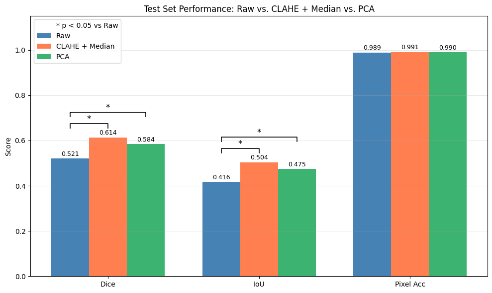
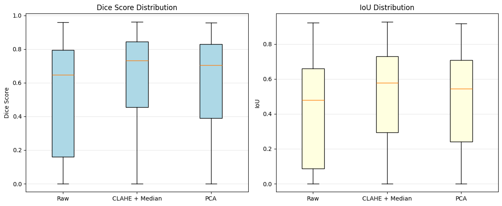
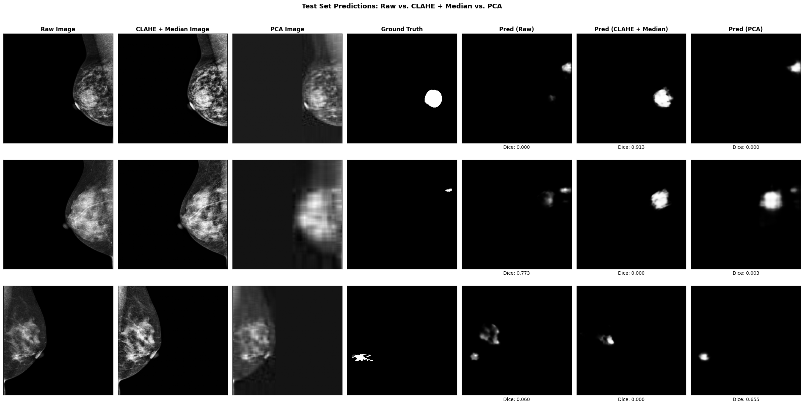

# CNNdetection

Exploratory work on tumor (mass) segmentation in mammograms. The goal is to take a working but basic U-Net pipeline and push it on two metrics at once:

1. **Higher Dice score** (a better segmentation model)
2. **Lower compute** (how images are packaged, stored, and fed to the GPU)

The approach is to apply open-source models, investigate CNN architecture and training choices, and use AI-assisted development to iterate quickly.

## Background

This started as a BME 303 (Imaging and Diagnostics, Duke) final project by Ella Etchandy, Paul Fong, and Ella Fortenbery, presented April 24, 2026 ([slides](https://docs.google.com/presentation/d/164Fi7TkFQRbLIuP3z_y9shHJBSYE3Jp7heBpFcq061U/edit?usp=sharing)). The original question was whether classical preprocessing (median filter + CLAHE, or PCA) changes how well a CNN segments masses.

**Baseline** ([`notebooks/CNN_tumor.ipynb`](notebooks/CNN_tumor.ipynb)): U-Net with an ImageNet-pretrained EfficientNet-B0 encoder (`segmentation_models_pytorch`), 256x256 inputs, BCE loss, Adam at 1e-3, batch size 4, 20 epochs, 80/20 image-level split on 1013 images.

| Preprocessing   | Dice  | IoU   |
|-----------------|-------|-------|
| Raw             | 0.521 | 0.416 |
| CLAHE + median  | 0.614 | 0.504 |
| PCA (90% var.)  | 0.584 | 0.475 |

CLAHE + median and PCA both beat raw (paired t-test, p < 0.01); they were not significantly different from each other.

### Baseline results



*Mean test-set scores (n = 203). Pixel accuracy is near 1.0 for every model because ~99% of pixels are background; Dice and IoU are the informative metrics.*



*Per-image distributions. The wide spread, with many images near zero, is the main thing to fix: the models either find the mass or miss it entirely.*



*Three test images. At 256x256 a mass can be only a few pixels wide (middle row), and each model finds some masses and misses others, which motivates breast-region cropping and higher-resolution inputs.*

More figures (preprocessing comparisons, histograms, training curves) are in [`docs/figures/`](docs/figures/).

### Inside the network

[`docs/explainer/`](docs/explainer/) is an interactive explainer of the exact model trained here (U-Net with EfficientNet-B0 encoder): click through the architecture, slide real learned kernels over a tissue patch, compare max/average pooling with stride-2 convolution, and browse all 219 layers. The numbers behind it are traced from the live model by `python -m src.model_inspect`:

| | |
|---|---|
| Trainable parameters | 6,250,893 (encoder 4.0M pretrained, decoder 2.2M from scratch, head 145) |
| Convolutions | 91 (16 depthwise, 63 pointwise 1×1; kernels 3×3, 5×5, 1×1) |
| Pooling layers | 0 (downsampling is five stride-2 convolutions, 256 → 8 px) |
| Activations | SiLU in the encoder, ReLU in the decoder |

## Dataset

[TOMPEI-CMMD](https://www.cancerimagingarchive.net/analysis-result/tompei-cmmd/) (The Cancer Imaging Archive, CC BY 4.0): MLO-view mammograms from the CMMD collection with JSON polygon annotations for masses, calcifications, and other findings. Images were converted from DICOM to 8-bit PNG (2294x1914) for this project.

The data is **not** in this repo. Download it from TCIA and set the Drive paths at the top of the notebook.

> Kashiwada, Y., Takaya, E., Hiroya, M., Matsuda, N., Yashima, T., Kobayashi, T., Tamiya, G., & Ueda, T. (2025). TOMPEI-CMMD Dataset (Version 1) [Dataset]. The Cancer Imaging Archive. https://doi.org/10.7937/WEZW-BH22

## Repository layout

```
notebooks/   Colab notebooks (baseline pipeline, with outputs)
src/         Reusable Python modules (model_inspect.py so far; data, training, evaluation to come)
docs/        Figures, experiment log (EXPERIMENTS.md), interactive CNN explainer (explainer/)
experiments/ One folder per experiment (config + results, no data or weights)
```

See [`CLAUDE.md`](CLAUDE.md) for the working agreement (git workflow, scientific standards, roadmap).

## Roadmap

Planned experiments, roughly in order:

1. **Package the dataset once.** Preprocess, rasterize masks, and resize a single time; store as uint8 arrays at training resolution instead of decoding full-resolution PNGs every epoch. Add mixed precision and data-loader workers.
2. **Crop to the breast and raise resolution.** Remove background so the pixel budget goes to tissue; test 512 and larger inputs or lesion-centered patches.
3. **Proper training recipe.** Carve out a validation set for early stopping, switch to Dice+BCE or Focal Tversky loss, add augmentation.
4. **Hyperparameter sweeps.** Preprocessing parameters (median kernel size, CLAHE clip limit / tile size), encoder size, learning rate, input resolution.
5. **Open-source models.** Mammography-pretrained encoders (Mammo-CLIP, VersaMammo) in the same U-Net; nnU-Net 2D as a reference ceiling.

## Running

**Training (Colab):** open the notebook with a GPU runtime, mount Drive, set `rawDataFolderPath` / `resultsFolderPath`, and run top to bottom. Cells marked OPTIONAL save intermediate files and are slow.

**Local development (CPU):**

```bash
python3 -m venv .venv && source .venv/bin/activate
pip install -r requirements.txt
python -m src.model_inspect --help   # trace the model, regenerate the explainer data
```

## AI disclosure

Conceptual planning was done by the team. AI tools (Claude, Gemini) were used for code troubleshooting during the original project and are used for development iteration in this exploratory phase.
